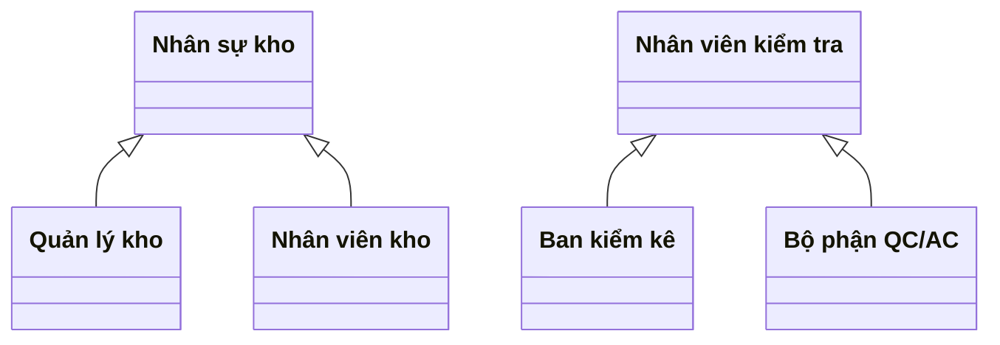
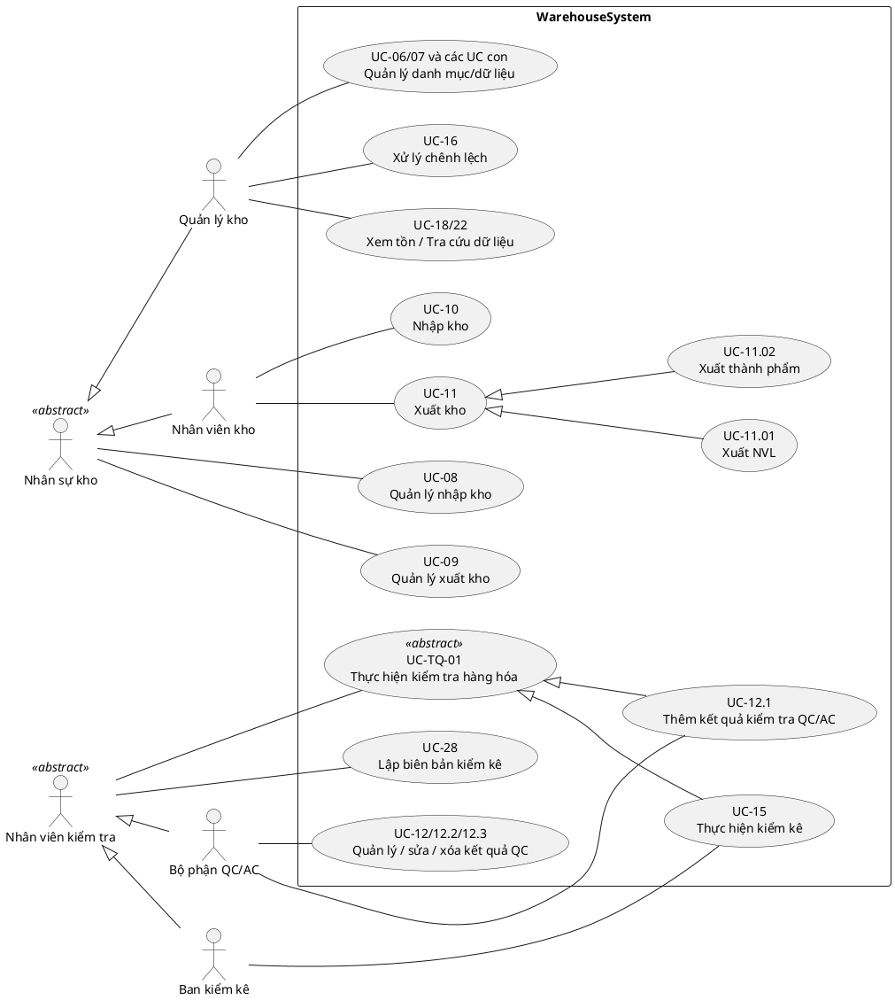

# Tổng quát hóa actor và use case

Cập nhật: 17/10/2026. Mô hình dùng để vẽ sơ đồ UC tổng quan và chi tiết, đối chiếu [đặc tả UC](DacTa_WarehouseSystem.md).

## 1. Cấu trúc actor

Giữ nguyên bốn actor nghiệp vụ, bổ sung hai actor cha trừu tượng:

| Actor cha | Actor con kế thừa | Tài khoản của actor con |
| --- | --- | --- |
| Nhân sự kho | Quản lý kho | `manager` |
| Nhân sự kho | Nhân viên kho | `staff`, `staff2` |
| Nhân viên kiểm tra | Ban kiểm kê | `stocktaker` |
| Nhân viên kiểm tra | Bộ phận QC/AC | `qc` |

Tam giác rỗng hướng từ actor con lên actor cha. Hai actor cha mô tả phần chung trên mô hình UML, không cần tài khoản đăng nhập riêng. Actor con kế thừa liên kết của cha; các actor cùng cha không kế thừa quyền riêng của nhau.

## 2. UC dùng chung và UC chuyên biệt

### Nhân sự kho

| Nối trực tiếp với actor | UC | Phạm vi |
| --- | --- | --- |
| Nhân sự kho | UC-08 Quản lý nhập kho | Xem danh sách, tìm kiếm và chi tiết phiếu nhập trong phạm vi được cấp |
| Nhân sự kho | UC-09 Quản lý xuất kho | Xem danh sách, tìm kiếm và chi tiết phiếu xuất trong phạm vi được cấp |
| Quản lý kho | UC-06/06.1/06.2/06.3 | Quản lý, thêm, xóa, sửa danh mục |
| Quản lý kho | UC-07/07.1/07.2/07.3 | Quản lý, thêm, xóa, sửa dữ liệu danh mục |
| Quản lý kho | UC-16 | Xử lý chênh lệch theo quy trình duyệt đã thống nhất |
| Quản lý kho | UC-18, UC-22 | Xem tồn và tra cứu dữ liệu; các actor khác vốn được cấp quyền vẫn giữ liên kết riêng |
| Nhân viên kho | UC-10 | Thực hiện nhập kho |
| Nhân viên kho | UC-11, UC-11.01, UC-11.02 | Thực hiện xuất kho, xuất NVL và xuất thành phẩm |

UC-08/09 là tra cứu/quản lý danh sách chứng từ theo luồng hiện có, không bao gồm quyền ghi sổ của UC-10/11. Quản lý kho xem theo phạm vi quản lý; nhân viên kho xem theo phân công. Không đặt UC-22 ở actor cha trong phiên bản này vì đặc tả hiện tại chưa cấp UC đó cho Nhân viên kho.

### Nhân viên kiểm tra

| Nối trực tiếp với actor | UC | Phạm vi |
| --- | --- | --- |
| Nhân viên kiểm tra | UC-TQ-01 Thực hiện kiểm tra hàng hóa | UC cha trừu tượng; chuyên biệt thành kiểm chất lượng hoặc kiểm số lượng |
| Nhân viên kiểm tra | UC-28 Lập biên bản kiểm kê | Cả Ban kiểm kê và QC/AC được tham gia theo phân công như đặc tả hiện có |
| Ban kiểm kê | UC-15 Thực hiện kiểm kê | Ghi số đếm, lưu tạm và hoàn tất phần kiểm kê được giao |
| Bộ phận QC/AC | UC-12/12.1/12.2/12.3 | Quản lý, thêm, sửa, xóa kết quả QC theo trạng thái và điều kiện được phép |

QC/AC kế thừa UC-28 không có nghĩa được tự thực hiện UC-15. Ban kiểm kê không có quyền ghi kết luận chất lượng của UC-12.1. UC-13 lập đợt kiểm kê vẫn thuộc Ban giám đốc. Không tạo thêm UC “Biên bản chất lượng” vì chưa có yêu cầu nghiệp vụ riêng cho chứng từ đó.

## 3. UC cha trừu tượng UC-TQ-01

**Tên:** Thực hiện kiểm tra hàng hóa.

**Actor chính:** Nhân viên kiểm tra.

**Mục tiêu chung:** Ghi nhận kết quả kiểm tra hàng hóa trong phạm vi được phân công.

**Tiền điều kiện:** Actor con đã đăng nhập, có quyền và có đối tượng kiểm tra hợp lệ thuộc phân công.

**Luồng chung:**

1. Chọn công việc/đối tượng cần kiểm tra.
2. Hệ thống hiển thị thông tin hàng hóa và phạm vi được giao.
3. Người thực hiện nhập kết quả theo loại kiểm tra.
4. Hệ thống kiểm tra quyền, dữ liệu và trạng thái đối tượng.
5. Lưu kết quả và cập nhật trạng thái theo quy tắc của UC chuyên biệt.

**Hậu điều kiện:** Kết quả hợp lệ được lưu và truy vết đúng đối tượng/người thực hiện; kết quả không hợp lệ không được ghi nhận.

| UC con kế thừa UC-TQ-01 | Đặc điểm chuyên biệt |
| --- | --- |
| UC-12.1 Thêm kết quả kiểm tra QC/AC | Nhập lượng kiểm, lượng đạt/lỗi, mô tả lỗi theo dòng lô; áp dụng điều kiện QC |
| UC-15 Thực hiện kiểm kê | Nhập số đếm thực tế theo kho/phạm vi; đối chiếu snapshot; lưu tạm/hoàn tất kiểm kê |

UC-TQ-01 không thực thi độc lập, không tạo bảng mới và không tính là thêm một chức năng cần triển khai. Nó tổng quát hóa mục tiêu chung; chi tiết UC-12.1 và UC-15 vẫn được giữ để kiểm thử. Các UC quản lý danh sách/sửa/xóa QC không phải UC con của “Thực hiện kiểm tra”.

## 4. Sơ đồ UML có thể dùng trực tiếp

File [ACTOR_UC_GENERALIZATION.puml](ACTOR_UC_GENERALIZATION.puml) dùng ký pháp use case PlantUML. Đoạn dưới là sơ đồ trọng tâm; các actor khác của hệ thống tiếp tục nằm trong sơ đồ tổng thể.

Các ellipse ghi nhiều mã UC là nhóm rút gọn trên sơ đồ tổng quan, không phải UC hợp nhất hoặc quan hệ kế thừa mới. Khi vẽ chi tiết có thể tách lại từng UC tương ứng.

## 5. Áp dụng và truy vết

- UC-08/09: khi cập nhật đặc tả chính, actor chính tổng quát hóa thành Nhân sự kho, với phạm vi riêng cho hai actor con. Nguồn DacTa hiện ghi Quản lý kho; ghi nhận đây là thay đổi mô hình cần đồng bộ trong đợt chỉnh đặc tả.
- UC-28: thay cách biểu diễn hai actor hiện có bằng actor cha Nhân viên kiểm tra; vẫn phải kiểm tra phân công trước thao tác.
- UC-12.1 và UC-15: giữ mã, dữ liệu và actor chuyên biệt; thêm quan hệ kế thừa UC-TQ-01.
- Các actor Khách hàng, Lập kế hoạch, Mua hàng, Chủ xưởng và Ban giám đốc giữ riêng; không nằm dưới hai actor cha trên.
- Tài khoản, mã role, database và API hiện tại giữ nguyên. Tổng quát hóa UML không tự cấp thêm quyền runtime.
- Phiếu chấm vẫn gồm 10 module; test case của UC con tiếp tục dùng mã cũ. UC-TQ-01 được bao phủ bởi các ca UC-12.1 và UC-15, không nhân đôi số ca.

Tài liệu này là bản mô hình tổng quát hóa bổ sung. Các mâu thuẫn nguồn và vai trò duyệt ngoại lệ ở TEST_CASES.md vẫn cần xử lý riêng, không được giải quyết ngầm bằng kế thừa actor.
