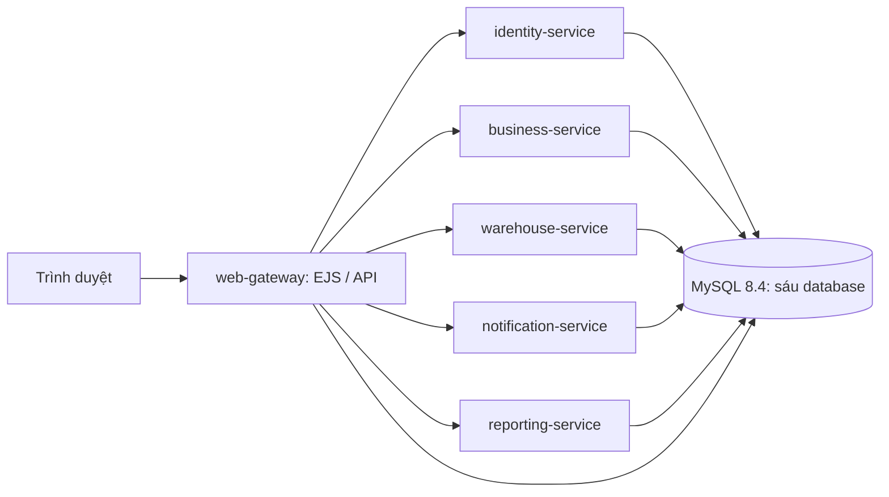

# Kiến trúc hiện tại

Cập nhật 14/10/2026, đối chiếu working tree, cấu hình Compose và entrypoint thực tế. Đây là kiến trúc đang triển khai; phần độc lập dữ liệu hoàn toàn vẫn còn phải làm.

## Service và quyền sở hữu

| Process / Compose | Database mặc định | Trách nhiệm |
| --- | --- | --- |
| identity-service | KhoHang_Identity | Đăng nhập, người dùng, vai trò, phạm vi xưởng, hồ sơ nhân viên |
| business-service | KhoHang_Business | Danh mục hàng/NCC, khách hàng, đơn hàng, kế hoạch, mua hàng, sản xuất và báo cáo sản xuất |
| warehouse-service | KhoHang_Warehouse | Kho/vị trí, lô, QC, yêu cầu/phiếu kho, tồn/giữ chỗ, kiểm kê, ngoại lệ, công việc, hàng trả |
| notification-service | KhoHang_Notification | Danh sách thông báo và trạng thái đọc |
| reporting-service | KhoHang_Reporting | Hồ sơ và truy vấn báo cáo tổng hợp; chưa có projection riêng |
| web-gateway / app | KhoHang_Gateway | EJS, assets, session, CSRF, chuyển API và gọi backend |

Tám boundary logic nằm trong `src/boundaries`. Catalog, Sales, Production, Procurement cùng business-service; Warehouse & Quality cùng warehouse-service. Boundary không tương đương một process/container.

## Luồng xử lý

Mỗi service có `src/services/<service>/index.js`, `Dockerfile`, `compose.js` và module thuộc owner. Controller/route → service nghiệp vụ → SQL/repository vẫn áp dụng bên trong từng service; giao diện EJS chỉ do gateway phục vụ.

Gateway chọn owner theo `src/services/shared/contracts.js`; SSR dùng HTTP clients. Backend nhận request nội bộ có chữ ký HMAC ràng buộc audience/path/body/time/nonce, kiểm allowlist và lấy lại actor/quyền/session version từ Identity. Không tin vai trò truyền từ browser. Mutation không tự retry; timeout cần đối soát kết quả bằng chứng từ/idempotency key.

## CSDL và giới hạn

Sáu database và tài khoản đã tách, bảng vật lý thuộc một owner. View tương thích, FK, JOIN, transaction và một số quyền ghi xuyên schema vẫn tồn tại. Vì vậy các database phải cùng MySQL server hiện tại; container riêng chưa đồng nghĩa độc lập triển khai dữ liệu.

Business còn ghi đăng ký lô/thông báo qua SQL; Reporting đọc dữ liệu nguồn trực tiếp; audit/idempotency dùng chung tạm thời. Chưa có broker, outbox/inbox, projections, source claims hoặc saga. Chi tiết quyền/migration: [SERVICE_DATABASES.md](SERVICE_DATABASES.md).

Runtime legacy `src/server.js` và `start:legacy` còn để đối chiếu/test, không phải entrypoint Compose. `src/modules` cũ đã được chuyển sang `src/services/<owner>/modules`. Các helper và adapter dùng chung chưa được loại bỏ.

## Bước tiếp theo

1. Tách truy vấn/ghi xuyên owner thành hợp đồng API rõ ràng, giữ invariant nghiệp vụ.
2. Thêm outbox/inbox và xử lý sự kiện idempotent cho thông báo, đăng ký lô và dữ liệu tổng hợp.
3. Thiết kế claims/compensation cho nhu cầu, giữ chỗ và các thao tác liên service.
4. Thay FK/view xuyên schema và thử các database trên server riêng.
5. Nghiệm thu lỗi mạng, restart, cạnh tranh, migration/backup/restore và production.

Tiến độ nghiệp vụ: [IMPLEMENTATION_PROGRESS.md](IMPLEMENTATION_PROGRESS.md). Kế hoạch chuyển tiếp: [MICROSERVICE_MIGRATION.md](MICROSERVICE_MIGRATION.md).
