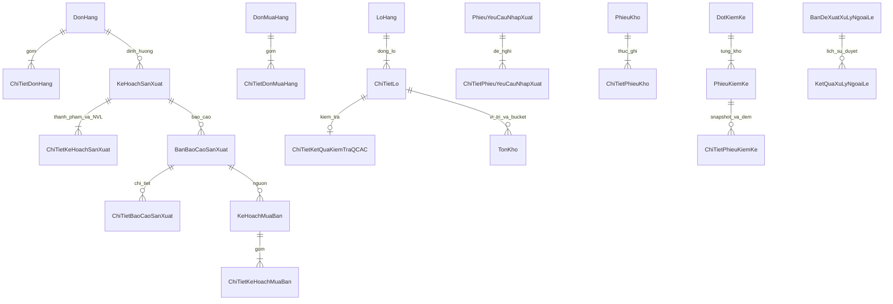

# Domain và ánh xạ CSDL hiện hành

Hợp nhất 14/10/2026. Mô hình nghiệp vụ và bảng vật lý không phải quan hệ một lớp = một bảng. Tên thuộc tính vật lý lấy snapshot/mapping; không coi thuộc tính minh họa trong sơ đồ Word là DDL đã áp dụng.

## Owner

Identity giữ người dùng/vai trò/phạm vi; Business giữ khách/xưởng/danh mục hàng, đơn, kế hoạch, mua và báo cáo SX; Warehouse giữ kho/lô/QC/yêu cầu/phiếu/tồn/kiểm kê/ngoại lệ/công việc; Notification giữ thông báo; Reporting giữ view/hồ sơ đọc; Gateway giữ session. Sáu database vẫn cùng MySQL và còn FK/view/transaction xuyên schema.

## Quan hệ chính

Sơ đồ thể hiện quan hệ nghiệp vụ chính; FK và NULL thực tế ở snapshot, không thay DDL bằng sơ đồ.

## Bảng chung và view

- ChiTietKeHoachSanXuat phân loại dòng thành phẩm/NVL; các tên output/material cũ là view tương thích.
- BanBaoCaoSanXuat phân biệt SAN_XUAT/THANH_PHAM; ChiTietBaoCaoSanXuat dùng chung các dòng nhu cầu/thành phẩm/NVL thực dùng; ChiTietLoBaoCaoSanXuat truy vết lượng theo lô.
- LoHang phân loại NVL/THÀNH_PHẨM/TRẢ_VỀ; ChiTietLo giữ mặt hàng/lượng/ngày/QC/nguồn mua hoặc SX. Subtype trong domain không cần bảng riêng.
- PhieuKiemKe là phạm vi mỗi kho trong DotKiemKe, giữ kết luận. BienBanKiemKe là view, không phải entity vật lý hoạt động mới.
- HoSoKho là view tổng hợp phiếu/yêu cầu, không sao chép chứng từ sang bảng hồ sơ mới.
- ChungTuBuQC giữ ảnh trước/sau và phiên bản kết quả; TaiKiemChatLuong giữ xác nhận theo đề xuất. PhanBoXuLy giữ vị trí/lượng xử lý.
- PhanCongKho giữ lượng phân bổ và đã ghi; TonKho giữ bucket AVAILABLE/QUARANTINE; BienDongKho giữ lịch sử thực ghi.
- Bảng LuuTru giữ lịch sử chuyển đổi, không dùng làm nguồn ghi mới. NhanVien/BoPhan giữ hồ sơ/tham chiếu, không có yêu cầu CRUD nhân sự trong phạm vi này.

## Nguồn và điều kiện

1. Khách đặt đơn; planner tiếp nhận và lập KHSX cho xưởng. BGĐ duyệt đơn/kế hoạch liên quan.
2. Chủ xưởng tra cứu tồn khả dụng. Khi đang sản xuất, có thể gửi tiến độ/sự cố cho BGĐ; nếu có nhu cầu NVL thì gửi báo cáo NHU_CAU và chọn thêm planner.
3. Mua bổ sung theo kế hoạch MUA đã duyệt hoặc nhập đơn REPORT/MANUAL. Nhận hàng tạo lô/dòng lô, QC; phần đạt lập yêu cầu nhập, quản lý phân công, nhân viên ghi phiếu. QC không tự tạo tồn.
4. Xuất NVL lấy KHSX PLAN hoặc báo cáo NHU_CAU REPORT; kiểm nhu cầu cộng dồn, giữ chỗ và lô thực xuất.
5. Thành phẩm hoàn thành phần nào, chủ xưởng nhập tay yêu cầu phần đó theo KHSX; một đầu lô/KHSX, dòng lô riêng từng đợt. QC đạt mới nhập. Không cần báo cáo tổng kết trước khi nhập từng đợt.
6. Hoàn tất toàn bộ mới lập UC-35, lấy lại các dòng lô từng phần đã có. Không tạo lô hoặc nhập lần hai; sản lượng thực tế có thể khác dự kiến, NVL dùng không vượt đã cấp. Gửi tổng kết đánh dấu KHSX COMPLETED.
7. Planner lập BAN từ tổng kết, BGĐ duyệt. Xuất bán khi đã hoàn tất SX, đến ngày giao, còn thành phẩm QC đạt khả dụng; ghi lượng giao và trạng thái đơn. Hiện code dùng latest_delivery_date làm điều kiện ngày giao, chưa có lịch giao riêng.
8. Kiểm kê, công việc, kết luận, ngoại lệ và hàng trả vận hành theo quyền/phân công. Hàng cách ly chỉ giải phóng/loại bỏ/trả NCC sau phê duyệt; bù QC không sửa lịch sử phiếu.

## Thuộc tính và ràng buộc vật lý

Danh mục toàn bộ owner, TABLE/VIEW và cột: [generated/DATABASE_OBJECTS.md](generated/DATABASE_OBJECTS.md). DDL: database/services/schemas/<service>/001_schema.sql; alias: database/adminer/identifiers.json. Các FK/grants xuyên schema còn có chủ đích, không suy độc lập server từ tên owner.

Quy tắc: [SRS.md](SRS.md), [BUSINESS_DECISIONS.md](BUSINESS_DECISIONS.md). API và enum tiếng Anh giữ tương thích, discriminator vật lý khác tên UI phải qua adapter.

Ảnh danh mục: LoaiHang.DuongDanAnh / image_path, chọn/xem trước/bỏ ảnh, PNG/JPEG/WebP ≤5 MB. Migration service 007; file ở src/images/categories, Docker lưu volume category_images. Chi tiết: [CATEGORY_IMAGES.md](CATEGORY_IMAGES.md).