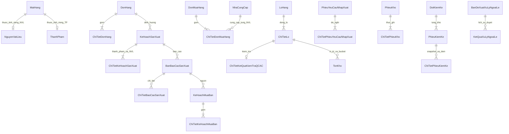

# Domain và ánh xạ CSDL hiện hành

Hợp nhất 14/10/2026. Mô hình nghiệp vụ và bảng vật lý không phải quan hệ một lớp = một bảng. Tên thuộc tính vật lý lấy snapshot/mapping; không coi thuộc tính minh họa trong sơ đồ Word là DDL đã áp dụng.

## Owner

Cập nhật 22/10/2026: KHSX hỗ trợ định lượng tính từ công thức cấu hình theo mã bánh và số lượng, lưu vào ChiTietKeHoachSanXuat hiện có. Chủ xưởng đối chiếu định lượng đã lưu với tồn khả dụng từ chi tiết KHSX; UC-34 lưu liên kết ảnh trong ghi chú, file nằm ở volume ảnh và đọc theo quyền báo cáo. Không tạo bảng/cột mới cho đợt này; xem [LUONG_DAT_HANG_TIEN_SAN_XUAT.md](LUONG_DAT_HANG_TIEN_SAN_XUAT.md). Các bản domain cũ đã khôi phục giữ nguyên.

Hiện tại các nhóm xác thực, danh mục, đơn hàng, sản xuất, mua hàng, kho, QC, kiểm kê, công việc và báo cáo là mô-đun trong cùng ứng dụng Express. Tất cả dùng một database `warehouse_db`; không còn gọi service qua mạng hoặc khóa ngoại xuyên schema. Bản microservice trước chuyển đổi được giữ riêng tại `archive/microservices-20261029/project` ở gốc repository.

## Quan hệ chính

Cập nhật lịch QC 22/10/2026: `DotKiemKe` loại QUALITY_CHECK có hai FK nguồn tùy chọn `MaKeHoachMuaQC` → `KeHoachMuaBan`, `MaKeHoachSanXuatQC` → `KeHoachSanXuat` (migration service 009). Lịch dự kiến chưa có ChiTietLo vẫn lưu được; chỉ sau gắn các phần hàng thực tế trong `LoLichKiemTra` mới bắt đầu. Ngày NVL dự kiến lấy MUA; ngày TP dự kiến lấy ngày giao của đơn gắn KHSX. TP từng phần hiện có dùng ngày yêu cầu nhập riêng, không đợi ngày giao cuối. Một LoHang có nhiều ChiTietLo theo đợt; QC duy nhất theo dòng, không gộp theo đầu lô. Không tạo lô/tồn giả cho kế hoạch chưa giao hàng.

Sơ đồ thể hiện quan hệ nghiệp vụ chính; FK và NULL thực tế ở snapshot, không thay DDL bằng sơ đồ.

## Bảng chung và view

- ChiTietKeHoachSanXuat phân loại dòng thành phẩm/NVL; các tên output/material cũ là view tương thích.
- BanBaoCaoSanXuat phân biệt SAN_XUAT/THANH_PHAM; ChiTietBaoCaoSanXuat dùng chung các dòng nhu cầu/thành phẩm/NVL thực dùng; ChiTietLoBaoCaoSanXuat truy vết lượng theo lô.
- LoHang phân loại NVL/THÀNH_PHẨM/TRẢ_VỀ; ChiTietLo giữ mặt hàng/lượng/ngày/QC/nguồn mua hoặc SX. Subtype trong domain không cần bảng riêng.
- PhieuKiemKe là phạm vi mỗi kho trong DotKiemKe, giữ kết luận. BienBanKiemKe là view, không phải entity vật lý hoạt động mới.
- HoSoKho là view tổng hợp phiếu/yêu cầu, không sao chép chứng từ sang bảng hồ sơ mới.
- ChungTuBuQC giữ ảnh trước/sau và phiên bản kết quả; TaiKiemChatLuong giữ xác nhận theo đề xuất. PhanBoXuLy giữ vị trí/lượng xử lý.
- PhanCongKho giữ lượng phân bổ và đã ghi; TonKho giữ bucket AVAILABLE/QUARANTINE; BienDongKho giữ lịch sử thực ghi.
- Bảng LuuTru giữ lịch sử chuyển đổi, không dùng làm nguồn ghi mới. NhanVien/BoPhan giữ hồ sơ/tham chiếu, không có yêu cầu CRUD nhân sự trong phạm vi này.

## Nguồn và điều kiện

1. Khách đặt đơn; planner tiếp nhận và lập KHSX cho xưởng. BGĐ duyệt KHSX; đơn hàng liên quan tự chuyển sang đã phê duyệt.
2. Chủ xưởng tra cứu tồn khả dụng. Khi đang sản xuất, có thể gửi tiến độ/sự cố cho BGĐ; nếu có nhu cầu NVL thì gửi báo cáo NHU_CAU và chọn thêm planner.
3. Mua nguyên vật liệu chỉ từ kế hoạch MUA đã được phê duyệt, chọn nhà cung cấp theo từng nguyên vật liệu. Kế hoạch mua có thể lập trực tiếp hoặc từ báo cáo nhu cầu nhưng đều phải được duyệt trước khi đặt mua. Nhận hàng tạo lô/dòng lô, QC; phần đạt lập yêu cầu nhập, quản lý phân công, nhân viên ghi phiếu. QC không tự tạo tồn.
4. Xuất NVL lấy KHSX PLAN hoặc báo cáo NHU_CAU REPORT; kiểm nhu cầu cộng dồn, giữ chỗ và lô thực xuất.
5. Chủ xưởng lập báo cáo thành phẩm UC-35 theo từng phần hoàn thành. Mỗi báo cáo tạo một phần gồm các dòng ChiTietLo riêng trong cùng LoHang của KHSX. Báo cáo tiến độ UC-34 không tạo phần. Giám đốc chọn loại công việc → lô → các phần theo báo cáo thành phẩm → nhân viên.
6. Nhiều báo cáo phần được phép; mỗi báo cáo ghi lượng phần mới. QC xong mới yêu cầu nhập đúng phần đạt, không cộng tồn bằng báo cáo. Báo cáo phần cuối có xác nhận hoàn tất mới chuyển KHSX COMPLETED. NVL dùng cộng dồn không vượt đã cấp. Migration 010 thêm KieuThanhPham để giữ tương thích báo cáo tổng kết cũ.
7. Planner lập BAN từ tổng kết, BGĐ duyệt. Xuất bán khi đã hoàn tất SX, đến ngày giao, còn thành phẩm QC đạt khả dụng; ghi lượng giao và trạng thái đơn. Hiện code dùng latest_delivery_date làm điều kiện ngày giao, chưa có lịch giao riêng.
8. Kiểm kê, công việc, kết luận, ngoại lệ và hàng trả vận hành theo quyền/phân công. Hàng cách ly chỉ giải phóng/loại bỏ/trả NCC sau phê duyệt; bù QC không sửa lịch sử phiếu.

## Thuộc tính và ràng buộc vật lý

Danh mục bảng, VIEW và cột: [generated/DATABASE_OBJECTS.md](generated/DATABASE_OBJECTS.md). Migration đang dùng: `database/monolith`; bản SQL import: `database/schema.sql`; ánh xạ tên SQL: `database/adminer/identifiers.json`. Mỗi mặt hàng có đúng một dòng con theo loại; bảng giá nhà cung cấp nằm tại `NguyenVatLieu`, hạn dùng mặc định nằm tại `ThanhPham`. Các dòng chứng từ vẫn tham chiếu mặt hàng chung. Không tách bảng lô nguyên vật liệu/thành phẩm: dùng `LoHang` với loại lô và `ChiTietLo` cho từng phần thực tế.

Quy tắc: [SRS.md](SRS.md), [BUSINESS_DECISIONS.md](BUSINESS_DECISIONS.md). API và enum tiếng Anh giữ tương thích, discriminator vật lý khác tên UI phải qua adapter.

Ảnh danh mục: LoaiHang.DuongDanAnh / image_path, chọn/xem trước/bỏ ảnh, PNG/JPEG/WebP ≤5 MB. File ở `src/images/categories`, Compose dùng volume `mono_images` gắn tại `/app/src/images`; không còn gateway riêng. Chi tiết: [CATEGORY_IMAGES.md](CATEGORY_IMAGES.md).

## Cập nhật 30/10/2026 — tổ chức kho và thứ tự điều phối

Kho liên kết Xuong bằng MaXuong, phân biệt ba loại bằng LoaiKho: MATERIAL, FINISHED_PRODUCT, RETURN. Một xưởng không có hai kho cùng loại. ViTriKho giữ TenKhu, MaLoaiHangPhuTrach và DoSau; chưa tạo entity Khu riêng. Dữ liệu mẫu A01–A10 có DoSau 1–10.

Thời điểm nhập đầu tiên được tính từ PhieuKho loại nhập và ChiTietPhieuKho tại kho đang điều phối; không thêm một bảng hàng đợi và không lấy NgayTao của lô làm ngày nhập. PhanCongKho tiếp tục lưu nhân viên, phần lô, vị trí và lượng. Quy tắc chỉ sắp thứ tự gợi ý; quyền và kiểm tra khi lưu không đổi.

Migration 007_workshop_warehouses.sql bổ sung liên kết kho/xưởng và loại kho; dữ liệu và vị trí cũ vẫn được bảo toàn. MatHang có hai bảng con NguyenVatLieu và ThanhPham; LoHang/ChiTietLo vẫn dùng chung, không tách lại bảng lô NVL/thành phẩm. Chi tiết: [WORKSHOP_STORAGE.md](WORKSHOP_STORAGE.md).
