## Cập nhật nghiệp vụ kho — 14/10/2026

Đã bổ sung xử lý hàng cách ly sau QC: đề xuất, giám đốc duyệt, quản lý giải phóng phần đạt hoặc loại bỏ phần lỗi. Điều chỉnh QC hàng đã nhập đi qua đề xuất cách ly, QC xác nhận và chứng từ bù/biến động tồn; không sửa phiếu nhập/giao cũ hoặc lượng đã giao. Giải phóng hàng điều chỉnh phải tái kiểm đạt. Không tự giao bù/hoàn tiền. Migration service hiện đến 006; chỉ làm nghiệp vụ kho, quản lý nhân viên/bộ phận ngoài phạm vi. Chi tiết API/quyền/quy trình: [WAREHOUSE_EXCEPTION_WORKFLOWS.md](WAREHOUSE_EXCEPTION_WORKFLOWS.md).
## Cập nhật: UC-23 nhập thành phẩm từng phần

Đã triển khai nhập tay từng đợt theo KHSX, chung một LoHang, mỗi đợt có ChiTietLo riêng để QC. Chưa cần báo cáo tổng kết khi lập đợt; chỉ phần đạt QC vào tồn. Tổng kết lấy lại các dòng lô đã ghi nhận, không tạo lô/nhập trùng; giữ lượng thực sản xuất, không ép bằng hoặc dưới dự kiến. Migration service 004 giữ dữ liệu cũ. Chi tiết, quyền và API: [PARTIAL_PRODUCTION_RECEIPTS.md](PARTIAL_PRODUCTION_RECEIPTS.md). Các ghi chú bên dưới nói UC-23 từng phần chưa làm thuộc mốc trước thay đổi này.

# Domain theo bản Word đã chốt

## Báo cáo trong quá trình sản xuất và tổng kết thành phẩm

BanBaoCaoSanXuat vẫn là bảng chung, LoaiBaoCao SAN_XUAT/THANH_PHAM. SAN_XUAT thêm MucDichBaoCao TIEN_DO/SU_CO/NHU_CAU, PhanTramTienDo và GuiBoPhanLapKeHoach. Tiến độ/sự cố có nhiều bản ghi theo thời điểm, không cần ChiTietBaoCaoSanXuat nhu cầu. NHU_CAU là nguồn NVL có dòng chi tiết; không dùng các mục đích khác để mua/cấp NVL.

THANH_PHAM lưu XacNhanHoanTat do chủ xưởng xác nhận hoàn tất toàn bộ; khi gửi đánh dấu kế hoạch COMPLETED. Giữ lịch sử lô/phiếu và báo cáo cũ, không suy đoán xác nhận hoàn tất cho dữ liệu cũ. Migration 026 bổ sung các trường và mở rộng view, không tạo bảng báo cáo tách mới.

## Cập nhật nguồn nhập theo yêu cầu mới

DonMuaHang có LoaiNguonDonMua PLAN/REPORT/MANUAL. PLAN liên kết kế hoạch mua và giữ quy tắc một đơn/kế hoạch; REPORT tham chiếu báo cáo nhu cầu mà không cần kế hoạch mua; MANUAL không có hai nguồn này. ChiTietDonMuaHang của REPORT/MANUAL không có dòng kế hoạch. Hạn mức thiếu báo cáo dùng chung kế hoạch mua có hiệu lực và đơn REPORT; không đếm đơn PLAN thêm lần nữa.

PhieuYeuCauNhapXuat xuất NVL có LoaiNguonSanXuat PLAN/REPORT. PLAN liên kết KeHoachSanXuat trực tiếp, REPORT liên kết báo cáo và suy ra kế hoạch. Tổng yêu cầu cùng kế hoạch được kiểm tra giữa cả hai kiểu nguồn. Nguồn hàng và QC/tồn/kiểm kê cho xuất thành phẩm vẫn truy vết qua kế hoạch bán, báo cáo thành phẩm và dòng lô; số đếm không phải số lượng xuất.

Migration 025 cho phép FK nguồn mua nullable và lưu loại nguồn, không suy đoán lại dữ liệu cũ. Mô tả bắt buộc báo cáo cho mọi đơn mua/xuất NVL bên dưới thuộc đặc tả trước cập nhật này.

Cập nhật 10/10/2026 theo bản Word đã chốt `Tuan6_WarehouseTeam_hoan_chinh_sequence.docx` và 12 quy tắc bổ sung của chủ đề tài. Word giữ nguyên, SHA-256: `19bbfb58491f8a220d838ea04291adc3381599550749e414c357868526482423`. Code đối chiếu tại commit `be92b4ef8aaface8152e4d429ba37e0041c60012`.

**Phân loại:** `[ĐÃ CHỐT]` là yêu cầu nghiệp vụ, không phải chứng nhận triển khai; `[ĐỀ XUẤT]` cần xác nhận trước khi lập trình; `[CẦN CHỐT]` còn mâu thuẫn/thiếu quy tắc; `[HIỆN TRẠNG]` chỉ có bằng chứng đọc code, chưa nghiệm thu MySQL trong lượt này. Truy vết và bằng chứng: [MODULE_MATRIX.md](MODULE_MATRIX.md); quyết định còn mở: [BUSINESS_DECISIONS.md](BUSINESS_DECISIONS.md).

Kế hoạch sản xuất là dự kiến ban đầu, phát sinh từ đơn hàng và phân công cho xưởng. `ChiTietKeHoachSanXuat` chứa cả dòng thành phẩm và dòng NVL cần/còn thiếu, phân biệt bằng `LoaiChiTiet`; không có entity chi tiết NVL kế hoạch riêng.

Xưởng đối chiếu kế hoạch với tồn kho để lập báo cáo sản xuất thực tế. Báo cáo sản xuất liên kết kế hoạch sản xuất, làm nguồn lập kế hoạch MUA, đơn mua NVL và yêu cầu xuất NVL cho sản xuất. Đơn mua vẫn liên kết kế hoạch MUA đã phê duyệt và đồng thời tham chiếu chính báo cáo nguồn đó.

Báo cáo thành phẩm ghi nhận kết quả sản xuất thực tế và làm nguồn lập kế hoạch BAN. Hai loại báo cáo tiếp tục dùng chung `BanBaoCaoSanXuat`, phân biệt bằng `LoaiBaoCao`; hai loại kế hoạch dùng chung `KeHoachMuaBan`, phân biệt bằng `LoaiKeHoach`. Các quan hệ có điều kiện theo loại phải được kiểm tra khi triển khai.

Trong sơ đồ, `N` biểu diễn nhiều. Các trường liên kết `MaBaoCao` tham chiếu báo cáo nguồn; số lượng báo cáo là dữ liệu thực tế, còn số lượng trong kế hoạch sản xuất là dự kiến. Các nhóm ngoài phạm vi sửa được giữ nguyên; tên báo cáo và xử lý ngoại lệ trong sơ đồ tổng thể được thống nhất với các nhóm chi tiết của file nguồn.

1. Nhóm Tài khoản / Người dùng

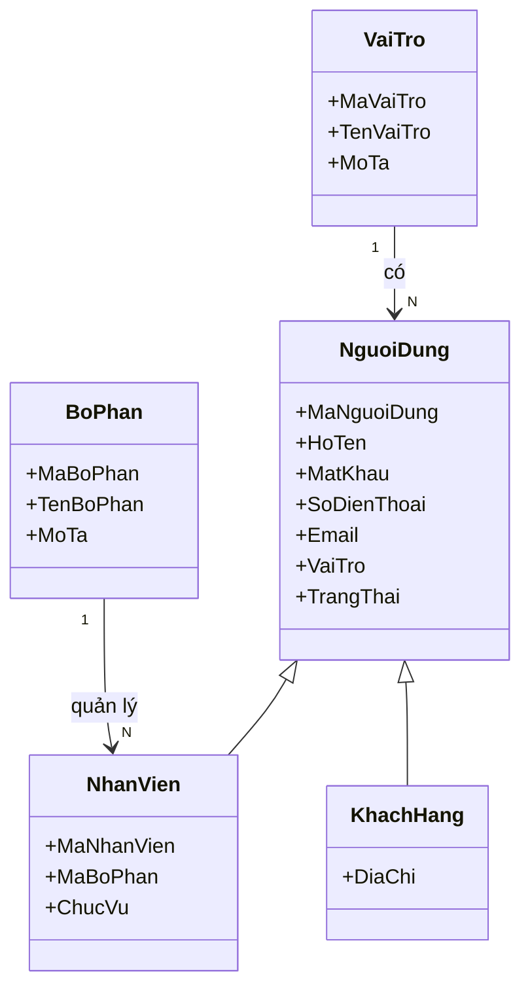

2. Nhóm Đơn hàng khách hàng

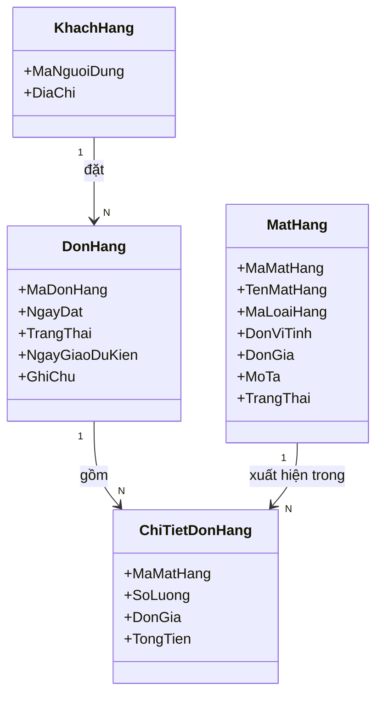

3. Nhóm Mặt hàng / Loại hàng

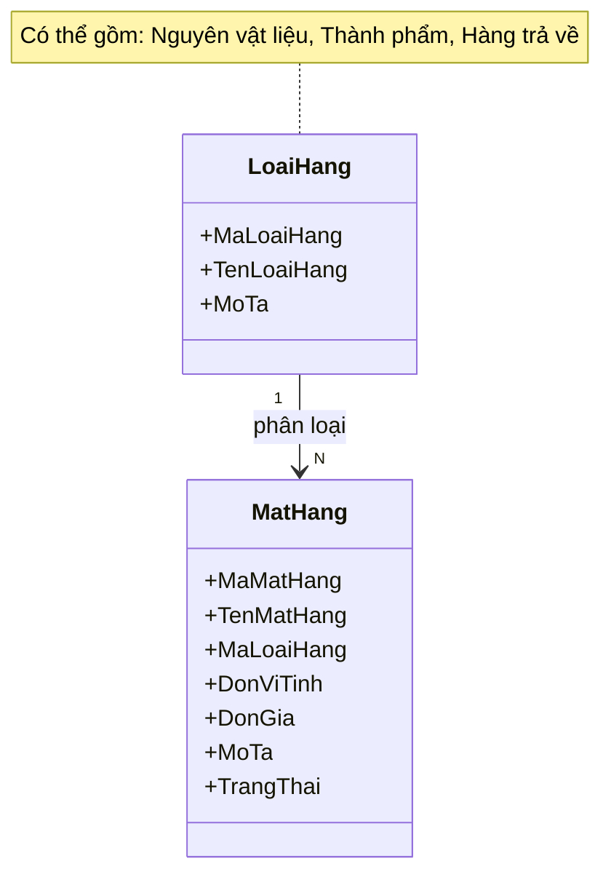

4. Nhóm Xưởng / Nhà cung cấp

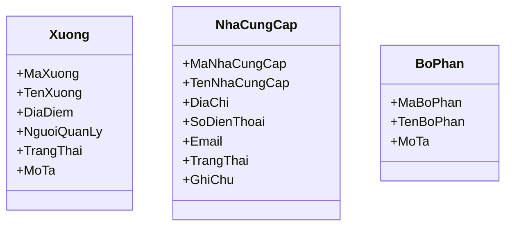

5. Nhóm Kế hoạch sản xuất

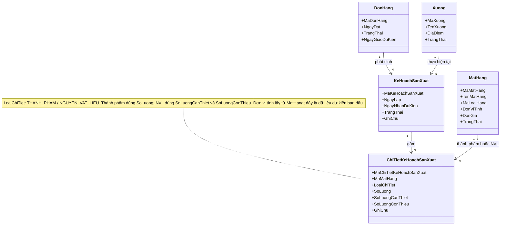

6. Nhóm Kế hoạch mua / bán và Đơn mua hàng

Kế hoạch mua lấy nhu cầu thiếu thực tế từ báo cáo sản xuất; kế hoạch bán lấy thành phẩm thực tế từ báo cáo thành phẩm. Hai loại báo cáo dùng chung BanBaoCaoSanXuat, phân biệt bằng LoaiBaoCao.

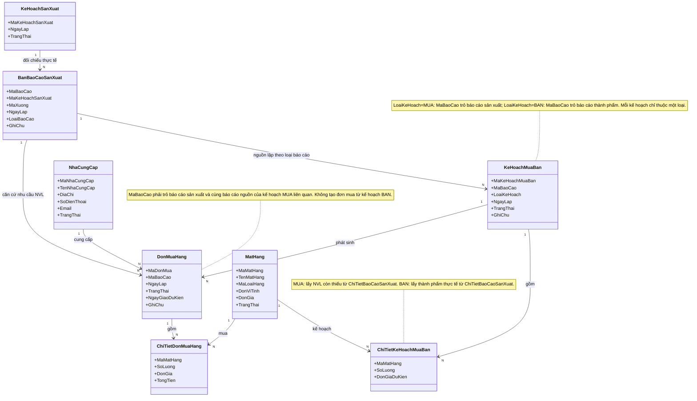

7. Nhóm Phiếu yêu cầu xuất/nhập và Phiếu kho

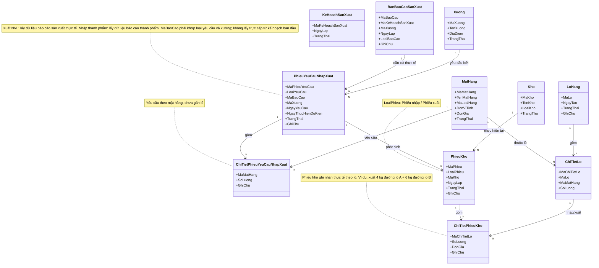

8. Nhóm Lô hàng

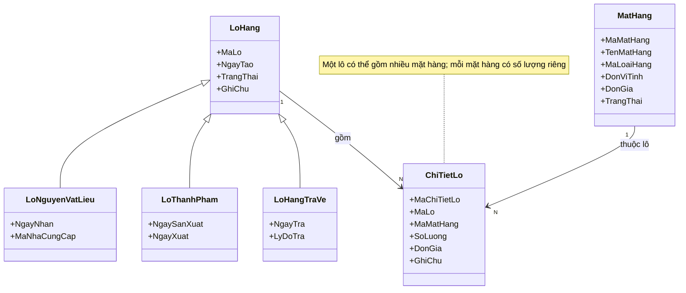

9. Nhóm Kho và Tồn kho

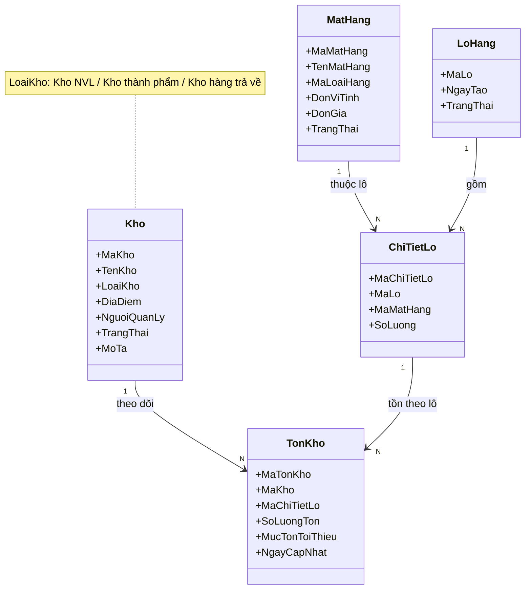

10. Nhóm Phiếu kiểm kê

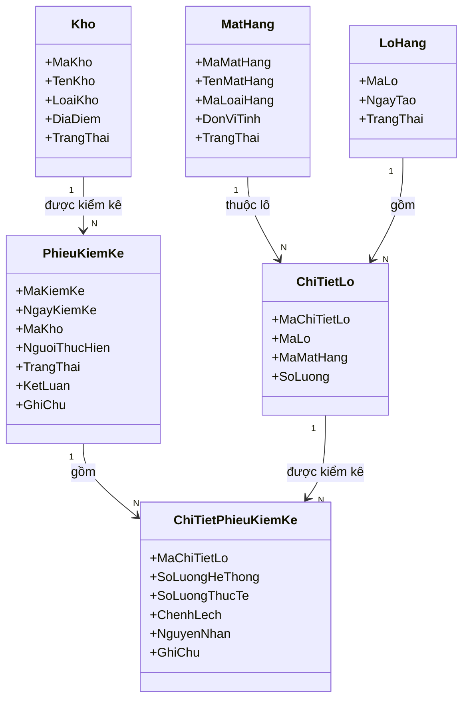

11. Nhóm Kiểm tra QC/AC

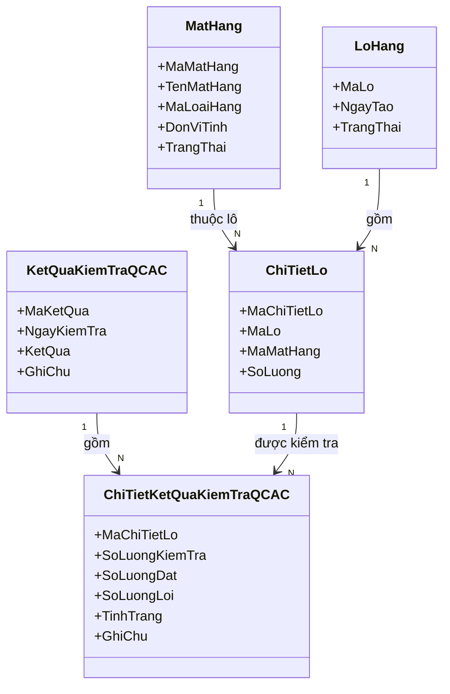

12. Nhóm Báo cáo sản xuất / Thành phẩm

Số lượng cần thiết và số lượng NVL sử dụng được tính **theo mặt hàng** (kèm đơn vị tính). Phần chia theo lô nằm ở bảng chi tiết riêng `ChiTietLoBaoCaoSanXuat`.

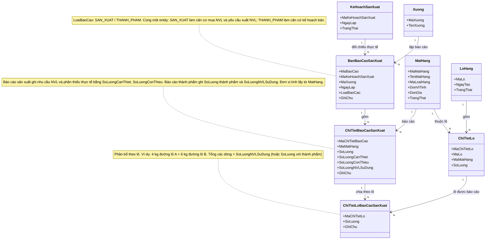

13. Nhóm Xử lý ngoại lệ

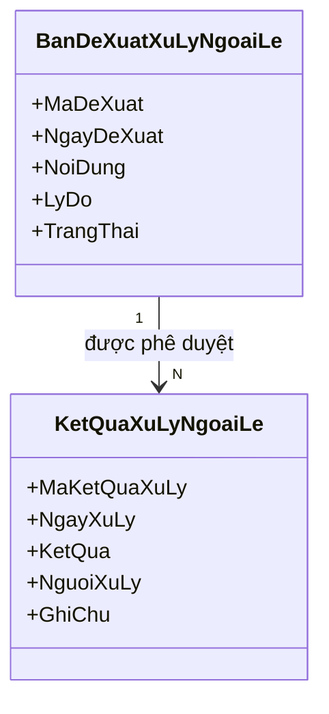

## Ràng buộc bổ sung đã xác nhận

| Quy tắc | Nội dung đã chốt và giới hạn |
| --- | --- |
| BR-01 Tiếp nhận đơn | UC-29 cập nhật trạng thái DonHang thành đã tiếp nhận, chờ UC-31 phê duyệt. Không tạo phiếu tiếp nhận riêng. |
| BR-02 Chi tiết kế hoạch và dự phòng | ChiTietKeHoachSanXuat chứa dòng THANH_PHAM và NGUYEN_VAT_LIEU qua LoaiChiTiet. Nhu cầu NVL dự kiến = nhu cầu gốc × 1,10, chỉ áp dụng một lần. Không có entity chi tiết NVL kế hoạch riêng. Quy tắc làm tròn cần chốt D-02. |
| BR-03 Báo cáo chung | BanBaoCaoSanXuat phân biệt SAN_XUAT và THANH_PHAM bằng LoaiBaoCao, liên kết KeHoachSanXuat và Xuong. SAN_XUAT được lập cả khi đủ và thiếu NVL; thiếu = max(0, nhu cầu thực tế − tồn khả dụng đối chiếu). Báo cáo không tự thay đổi tồn. |
| BR-04 Nguồn mua và bán | KeHoachMuaBan MUA lấy phần thiếu thực tế từ báo cáo SAN_XUAT; BAN lấy nguồn báo cáo THANH_PHAM và đối chiếu đơn khách, QC, tồn khả dụng. Không mua trực tiếp từ kế hoạch dự kiến; không cộng 10% lần nữa. |
| BR-05 Đơn mua và giới hạn cộng dồn | DonMuaHang chỉ tạo từ kế hoạch MUA đã duyệt, tham chiếu cùng MaBaoCao. Tổng lượng mua có hiệu lực theo báo cáo/mặt hàng không vượt phần thiếu; kiểm lại lúc tạo, sửa, duyệt và mua, trong transaction chống cạnh tranh. Chính sách tính đơn bị hủy/trả hàng và nhiều đơn cho một kế hoạch cần chốt D-04. |
| BR-06 Lô nhiều mặt hàng | LoHang 1–N ChiTietLo; mỗi dòng tham chiếu MatHang. LoNguyenVatLieu, LoThanhPham, LoHangTraVe là các chuyên biệt của LoHang trong domain Word; không phải ba cách gọi tùy ý của một mặt hàng. Lựa chọn bảng vật lý và ý nghĩa hàng trả cần chốt D-05. |
| BR-07 QC từng dòng | ChiTietKetQuaKiemTraQCAC tham chiếu ChiTietLo. Lượng kiểm tra = lượng đạt + lượng lỗi. Chỉ phần đạt được chuyển UC-10 nhập kho; tổng nhập không vượt phần đạt chưa nhập. Lỗi trả NCC hoặc xử lý ngoại lệ, không thuộc tồn khả dụng. Không tự giảm tồn cho lượng lỗi chưa từng nhập. |
| BR-08 Xuất NVL thực tế | UC-23 tạo PhieuYeuCauNhapXuat từ báo cáo SAN_XUAT; ChiTietPhieuYeuCauNhapXuat ghi lượng đề nghị theo mặt hàng. UC-11.01 ghi lượng và ChiTietLo thực xuất trong ChiTietPhieuKho. Chặn cấp trùng/vượt nhu cầu thực tế, xét cả phần đã cấp và cam kết đang có hiệu lực. SoLuongConThieu dùng mua, không phải lượng mặc nhiên xuất. |
| BR-09 Tồn và giữ chỗ | Tồn khả dụng = lượng đã nhập và đạt QC, còn hạn, đủ điều kiện giao dịch − lượng giữ chỗ có hiệu lực; phần lỗi/cách ly không cộng vào. Giữ chỗ chưa làm giảm tồn vật lý, ghi xuất giảm tồn và tiêu thụ giữ chỗ đúng một lần. Thời điểm giữ/giải phóng và phạm vi khóa kiểm kê còn cần chốt D-01/D-07; phương án ở mục dưới là đề xuất. |
| BR-10 Hồ sơ kho | UC-19/20 đọc tổng hợp từ PhieuKho và ChiTietPhieuKho, liên kết ChiTietLo/MatHang/Kho. Không entity hồ sơ riêng, không ghi movement hoặc số lượng lần hai khi tổng hợp. |
| BR-11 Kết luận kiểm kê | UC-28 do Ban kiểm kê hoặc Bộ phận QC/AC thực hiện trong phạm vi được phân công; lưu kết luận, nhận xét, trạng thái trên PhieuKiemKe. ChiTietPhieuKiemKe lưu số đếm theo dòng lô. Không entity biên bản riêng; vẫn giữ mã UC-15 và UC-28. |
| BR-12 Ngoại lệ và lịch sử | Thống nhất BanDeXuatXuLyNgoaiLe 1–N KetQuaXuLyNgoaiLe. UC-17 thuộc Ban giám đốc; mỗi quyết định lưu người, thời điểm, kết quả, lý do, phiên bản nguồn và phương án. Giữ lịch sử, không ghi đè quyết định cũ. Duyệt khác thực hiện vật lý; hạn mức UC-16 và vòng sửa/gửi lại cần chốt D-08/D-09. |

## Tồn khả dụng và giữ chỗ

[ĐÃ CHỐT] Tính theo kho/vị trí/ChiTietLo và đơn vị của MatHang. Không cộng chung các đơn vị khác nhau. Lượng đã giữ không thể được phân bổ lại cho yêu cầu khác. Kiểm nhu cầu nguồn và số dư phải thực hiện nguyên tử, không chỉ kiểm lúc mở form. Preview và báo cáo thiếu là ảnh đối chiếu tại thời điểm đọc, không chứng minh lượng tồn đã dành riêng cho xưởng.

[ĐỀ XUẤT, D-01] Chỉ giữ chỗ khi quản lý kho xác nhận phân bổ lô; xem preview/lưu nháp/gửi yêu cầu không giữ. Khóa nguồn nhu cầu, yêu cầu và các dòng tồn theo thứ tự ổn định, rồi kiểm `giữ mới <= tồn đủ điều kiện - giữ đang hiệu lực`. Khi xuất một phần: giảm tồn vật lý và giảm giữ tương ứng trong cùng transaction. Hủy hoặc đổi phân bổ chưa xuất: giải phóng phần chưa dùng đúng một lần; phần đã xuất giữ lịch sử, không hoàn tồn tự động. Hủy yêu cầu cần kiểm lượng đã xuất và phần cam kết còn lại. Lỗi transaction không tạo giữ/phiếu một phần. Không tự đặt thời hạn hết giữ hoặc giải phóng vì mất phiên khi chưa chốt.

[ĐỀ XUẤT, D-03] Theo mỗi báo cáo/mặt hàng: `nhu cầu còn cấp = nhu cầu thực tế - đã xuất hợp lệ - lượng yêu cầu khác đang cam kết`; cam kết nhu cầu khác giữ chỗ lô. Phải chốt trạng thái nào bắt đầu cam kết, cách hợp nhất nhiều báo cáo của cùng kế hoạch và ảnh hưởng hoàn trả NVL. Tồn bổ sung làm thay đổi khả năng cấp; không âm thầm viết lại báo cáo nguồn đã gửi.

## Trạng thái nghiệp vụ và quyền

| Đối tượng | Trạng thái trong Word | Ràng buộc và điểm mở |
| --- | --- | --- |
| DonHang | Chờ tiếp nhận → Đã tiếp nhận, chờ duyệt → Đã duyệt / Từ chối | UC-29 không đồng nghĩa UC-31; sửa chỉ trạng thái được phép, cần D-10 |
| KeHoachSanXuat | Nháp / Chờ duyệt / Đã duyệt / Đang thực hiện / Hoàn thành | Duyệt cùng đơn và xử lý kế hoạch khi đơn bị từ chối cần D-11 |
| BanBaoCaoSanXuat | Nháp → Đã gửi | LoaiBaoCao quyết định nguồn; sửa/gửi lại sau phát sinh cần D-03 |
| KeHoachMuaBan | Chờ duyệt → Đã duyệt / Từ chối; xử lý/hủy theo quyền | Duyệt không tự nhập/xuất; mã enum vật lý cần ánh xạ |
| PhieuYeuCauNhapXuat | Chờ duyệt / Chờ xử lý; Đang xử lý / Một phần / Hoàn tất / Hủy | Word dùng hai tên ban đầu; chưa xác nhận người duyệt hoặc bỏ duyệt, D-06 |
| PhieuKho | Đã ghi sổ | Không sửa số lượng lịch sử trực tiếp; cách bù sai cần D-13 |
| PhieuKiemKe | Được lập → Đếm → Hoàn tất đếm → Lưu kết luận / Gửi | Có kết luận không tự điều chỉnh tồn; phạm vi theo kho cần D-07 |
| BanDeXuatXuLyNgoaiLe | Chờ phê duyệt → Đã duyệt / Từ chối | Ban giám đốc duyệt UC-17, lưu KetQuaXuLyNgoaiLe mỗi quyết định |

[ĐỀ XUẤT, D-09] Ngoại lệ có NHAP → CHO_PHE_DUYET → DA_DUYET hoặc TU_CHOI; bản từ chối sửa thành phiên bản mới rồi gửi lại; trạng thái thực hiện CHUA_THUC_HIEN / DANG_THUC_HIEN / DA_THUC_HIEN / THAT_BAI tách khỏi kết quả duyệt. Mỗi lần duyệt/từ chối lưu append-only lịch sử; đối chiếu phiên bản và khóa đề xuất để chống hai quyết định cạnh tranh. Người đề xuất không tự được quyền duyệt. Việc kiểm tra người duyệt có thể trùng người đề xuất cần xác nhận, không suy ra từ vai trò.

Quyền theo Word: UC-22 Quản lý kho và Chủ xưởng; UC-28 Ban kiểm kê và Bộ phận QC/AC; UC-18 Ban giám đốc, Chủ xưởng, Quản lý kho. Quyền xem không cấp quyền ghi phiếu/QC hoặc truy cập mọi xưởng. Phạm vi kho dùng chung chưa được chốt (D-12).

## Phạm vi mô hình và khoảng trống

CongViec được giữ theo đặc tả UC-13/15/21/25 và các UC con; hình domain Word chưa có class này. Không xóa UC công việc vì hình thiếu class, cũng không tự khẳng định trường/quan hệ CongViec đã chốt. Domain biểu diễn nghiệp vụ, không bắt buộc mỗi lớp có một bảng SQL riêng. Không thêm entity chi tiết NVL kế hoạch, hồ sơ kho hoặc biên bản kiểm kê riêng.

Đơn mua→dòng lô nhận, báo cáo thành phẩm→dòng lô thành phẩm, QC→dòng phiếu nhập và truy vết trả NCC cần xác nhận cardinality/chứng từ (D-05/D-13). ChiTietLoBaoCaoSanXuat trong Word phục vụ phân bổ NVL sử dụng/thành phẩm theo dòng lô; tổng phân bổ khớp lượng theo mặt hàng. Cách theo dõi tồn tại xưởng vẫn mở (D-12).
