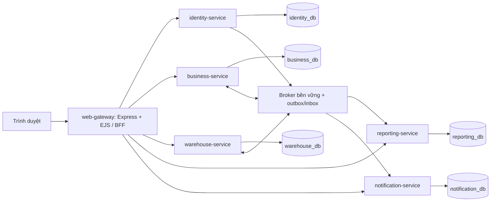

## MySQL theo service - cập nhật hiện hành

Đã tách bảng vật lý thành 6 database/tài khoản MySQL, có migration chuyển dữ liệu, checkpoint và backup. Vẫn dùng một MySQL server với FK/view/transaction xuyên schema để giữ nghiệp vụ. Các mô tả schema chung phía dưới là lịch sử. Xem [SERVICE_DATABASES.md](SERVICE_DATABASES.md) để biết cấu hình, ownership, migration, backup và giới hạn hiện tại.

# Kế hoạch chuyển WarehouseSystem sang microservice

## Hiện trạng mới: service độc lập, CSDL chưa tách

Theo yêu cầu tiếp theo, service đã chuyển vào `app/src/services`, mỗi service có index.js/Dockerfile riêng. Compose chạy Identity, Business, Warehouse, Notification, Reporting và Web Gateway bằng HTTP nội bộ; module nghiệp vụ chuyển vào owner, thư mục `app/services`, `app/apps`, `src/modules` cũ đã bỏ. Tám boundary logic giữ nguyên. Hướng dẫn hiện hành: [services README](../src/services/README.md).

Người dùng yêu cầu chỉnh CSDL sau, nên **schema 026/volume hiện có được giữ**. Đây là tách runtime/container, chưa là độc lập dữ liệu: vẫn account/schema chung, SQL/FK xuyên boundary, chưa outbox/broker/projection/claims. Các mô tả in-process/chưa có server ở giai đoạn trước dưới đây là lịch sử; kiến trúc đích database-per-service và lộ trình chuyển dữ liệu vẫn cần thực hiện.

Ngày lập: **13/10/2026**. Phạm vi: thiết kế và bàn giao chuyển đổi; chưa chuyển code, CSDL hay Docker Compose sang microservice.

**Cập nhật triển khai 13/10/2026:** đã bắt đầu P1 ở mức composition và ownership: tám boundary trong `src/boundaries`, năm entrypoint nhóm backend ở `services/*/src`, entrypoint web ở `apps/web-gateway/src`. Runtime/boot/Dockerfile đã dùng cấu trúc này; xử lý lô tách khỏi Catalog, mutation kế hoạch MUA/BÁN điều phối theo owner. Vẫn cùng process/pool/CSDL; chưa có service HTTP độc lập, broker, outbox/inbox hoặc claims phân tán. Các mô tả “chưa chuyển code” bên dưới là mốc lập tài liệu, không phủ nhận bước refactor này.

Tám boundary logic được chốt: Identity, Catalog, Sales, Production, Procurement, Warehouse & Quality, Notification, Reporting. Catalog/Sales/Production/Procurement ở business-service; QC/kho/giữ/kiểm kê/công việc vẫn cùng warehouse-service. Xem [boundary README](../src/boundaries/README.md) và [service entrypoint README](../src/services/README.md).

Tài liệu dựa trên **working tree hiện tại**, không chỉ commit HEAD `be92b4e`. Nhiều thay đổi sau commit này chưa được commit. Nguồn tiến độ: [IMPLEMENTATION_PROGRESS.md](IMPLEMENTATION_PROGRESS.md); yêu cầu mới nhất nằm ở đầu [SRS.md](SRS.md), [USE_CASES.md](USE_CASES.md), [DOMAIN_MODEL.md](DOMAIN_MODEL.md). Các phần lịch sử phía dưới tài liệu cũ có thể đã hết hiệu lực.

## 1. Hiện trạng cần giữ

Ứng dụng hiện là monolith Express + EJS + mysql2/MySQL, nằm trong `app/`. Giao diện tiếng Việt cho xưởng bánh đóng gói, màu hồng–đen–trắng. Chưa có broker, service độc lập, outbox/inbox hay giao dịch phân tán.

| Thành phần | Vị trí và cách hoạt động hiện tại |
| --- | --- |
| Khởi động | `src/server.js`, `src/shared/runtime.js`, `src/shared/create-mysql-app.js` |
| Dịch vụ nghiệp vụ | `src/modules/*`; phần lớn service gọi SQL trực tiếp |
| API | `src/shared/ModuleRoutes.js`; registry không thay thế route đã triển khai |
| Web | `FoundationWebRoutes`, `FoundationPageController`, EJS trong `src/views` |
| Trình duyệt | `public/js/app.js`, `forms.js`, `workflow-forms.js`, `source-imports.js`, `production-report-forms.js` |
| Quyền | `src/services/domain/policy.js`, middleware xác thực/phân quyền, scope theo khách/xưởng/phân công |
| CSDL | Một pool, một CSDL `KhoHang`, FK và transaction xuyên module |
| Tên SQL | `database/adminer/identifiers.json` và `src/config/vietnamese-sql.js` dịch identifier; JSON/API giữ tiếng Anh |
| Docker | Compose root include `app/docker-compose.yml`; project `warehouse-system`; setup secrets, MySQL, app, Adminer profile dev |
| Dữ liệu bền vững | Volume `mysql_data`, các volume secrets; không phụ thuộc seed lại |
| Migration | Các file 001–026 trong `database/migrations`; không sửa migration đã áp dụng |

**Bằng chứng trước chuyển đổi:** đợt 12/10/2026 đã ghi nhận migration 026, 26 kiểm thử Node, kiểm tra cú pháp, nghiệm thu MySQL cô lập và browser form đạt. Đây là kết quả monolith ở đợt trước; không chứng nhận microservice hoặc mọi nhánh của 48 UC. Lượt lập tài liệu này không chạy lại ứng dụng/DB. Bộ kiểm thử memory không thay thế kiểm thử SQL.

## 2. Quy tắc nghiệp vụ không được làm mất

- Giữ nguyên 48 mã UC gốc; UC-11.01/11.02 là nhánh của UC-11. Không tự thêm UC-26/30/33.
- Duyệt đơn và kế hoạch SX liên quan cùng một lần xử lý; sửa đơn chỉ trước duyệt.
- NVL dự kiến nhập lượng gốc, cộng 10% một lần, làm tròn lên 3 chữ số. Import báo cáo/mua không nhân dự phòng lần nữa.
- Đơn mua có PLAN/REPORT/MANUAL. PLAN giữ một đơn/kế hoạch. REPORT chia sẻ hạn mức thiếu với kế hoạch mua có hiệu lực; không đếm đơn PLAN thêm lần nữa. MANUAL không được tự coi là đã đáp ứng một báo cáo.
- Xuất NVL dùng PLAN hoặc REPORT; tổng yêu cầu phải được đối soát theo cùng KHSX giữa hai nguồn. PLAN không vượt nhu cầu thực tế đã gửi nếu có báo cáo nhu cầu.
- Chỉ ghi tồn trong nghiệp vụ kho. Tách lượng đề nghị, giữ chỗ và đã thực xuất/nhập. Giữ chỗ khi quản lý phân công; không tự hết hạn. Hủy phần chưa ghi mới được giải phóng.
- QC theo `ChiTietLo`: lượng kiểm = đạt + lỗi; phần lỗi không trở thành tồn khả dụng. Hàng hết hạn/cách ly không được xuất cho sản xuất hoặc bán.
- Kho kiểm kê bị khóa đến đóng đợt; `null` khác số đếm 0. Chênh lệch cần BGĐ duyệt, quản lý thực hiện riêng, có lịch sử và không ghi biến động trùng.
- UC-34: tiến độ/sự cố/thiếu NVL khi chưa hoàn tất. BGĐ luôn nhận khi gửi; planner chỉ xem/nhận khi được chọn gửi thêm. Tiến độ/sự cố không bắt nhập dòng NVL và không dùng làm nguồn mua/cấp.
- UC-35: tổng kết khi chủ xưởng xác nhận hoàn tất toàn bộ; sản lượng thực tế không bắt bằng kế hoạch. Gửi tổng kết đánh dấu kế hoạch COMPLETED. Hai loại báo cáo cùng bảng `BanBaoCaoSanXuat`, discriminator SAN_XUAT/THANH_PHAM.
- Hàng khách trả liên kết dòng giao gốc, có giới hạn cộng dồn, nhận một lần vào QUARANTINE. QC đạt vẫn cách ly; không tự giao bù/hoàn tiền hay sửa lịch sử giao.
- Chứng từ đã ghi/báo cáo đã gửi giữ bất biến; sửa sai qua chứng từ bù hoặc điều chỉnh đã duyệt. Không suy đoán nguồn hay xác nhận hoàn tất cho dữ liệu lịch sử.

## 3. Kiến trúc đích đề xuất

Đây là **đề xuất để triển khai**, chưa phải các service đang tồn tại. Giữ Express/mysql2, EJS và cấu trúc MVC bên trong mỗi service; chưa cần đổi frontend framework hay đưa Kubernetes vào phạm vi.



Đích gồm **5 service backend và 1 ứng dụng web-gateway**. Không tách ngay từng UC hoặc từng bảng thành service. `business-service` ban đầu cố ý giữ đơn hàng, kế hoạch, mua và sản xuất cùng nhau để giữ giao dịch duyệt và hạn mức nguồn. Chỉ tách purchasing/production tiếp khi đã có hợp đồng nguồn và cơ chế saga được nghiệm thu.

| Service | Trách nhiệm | Module/code chuyển từ hiện tại | UC chính |
| --- | --- | --- | --- |
| identity-service | Tài khoản, băm mật khẩu, vai trò, hồ sơ nhân viên, scope khách/xưởng, thu hồi phiên/quyền | auth, UserRepository, dữ liệu NhanVien/BoPhan, workshop_users | 01; quản trị hồ sơ hỗ trợ |
| business-service | Danh mục hàng, khách, NCC, xưởng; đơn khách; kế hoạch SX/mua/bán; đơn mua; báo cáo SX/thành phẩm; hạn mức nhu cầu | customer-orders, business-plans, purchasing, production; phần danh mục tương ứng | 02/03/03.1, 04/05 và nhánh, 14/27/29/31/32/34/35 |
| warehouse-service | Kho/vị trí, lô, QC/lịch QC, yêu cầu kho, giữ chỗ, phiếu, tồn/biến động, kiểm kê, ngoại lệ, hàng trả, công việc/phân công | warehouse, stock-requests, quality, stocktakes, exceptions, returns, tasks; phần catalog lô/kho | 06/07 và nhánh qua danh mục, 08–13, 15–17, 22–25 và nhánh, 28; 11.01/11.02 |
| notification-service | Hộp thông báo trong ứng dụng, trạng thái đã đọc; nhận sự kiện đã commit | notifications; thay các INSERT notification xuyên module | Hỗ trợ UC, không tạo mã UC mới |
| reporting-service | Read model tổng hợp, báo cáo tồn theo thời điểm, hồ sơ nhập/xuất, báo cáo kiểm kê, export | reporting, phần đọc WarehouseRecordService | 18/19/20/21 |
| web-gateway | EJS, assets, session phía browser, CSRF, API tương thích `/api/v1`, tổng hợp form/import | views/public, web controllers/routes; tách ModuleRoutes thành router/client | Giao diện các UC |

**Giữ QC và tồn cùng warehouse-service.** Nếu tách QC riêng ngay, quy tắc lượng đạt/lỗi, chứng từ bù, receipt và release sẽ mất transaction hiện có. Công việc và lịch phân công cũng ở warehouse-service để chống lịch chồng giữa công việc thường/kho/QC/kiểm kê. Vai trò BGĐ không quyết định service sở hữu dữ liệu phê duyệt.

## 4. Sở hữu dữ liệu và schema

| Owner | Bảng chính / dữ liệu |
| --- | --- |
| identity | NguoiDung, VaiTro, NguoiDungVaiTro, NhanVien, BoPhan, NguoiDungXuong, LanThuDangNhap; thông tin scope khách theo tài khoản |
| business | KhachHang, NhaCungCap, Xuong, LoaiHang, DonViTinh, MatHang; DonHang/ChiTietDonHang; KeHoachSanXuat/ChiTietKeHoachSanXuat; KeHoachMuaBan/ChiTietKeHoachMuaBan; DonMuaHang/ChiTietDonMuaHang; BanBaoCaoSanXuat/ChiTietBaoCaoSanXuat và dữ liệu tổng kết/tiêu hao |
| warehouse | Kho, ViTriKho, LoHang/ChiTietLo/ChiTietLoTraVe; QC/lịch QC/ChungTuBuQC/TaiKiemChatLuong; PhieuYeuCauNhapXuat/chi tiết; PhanCongKho; PhieuKho/chi tiết; TonKho/BienDongKho; kiểm kê/phân công/kết luận; ngoại lệ/lịch sử; CongViec/PhanCongCongViec |
| notification | ThongBao, inbox nhận sự kiện, tùy chọn read model người nhận |
| reporting | Các bảng projection riêng; không sở hữu hay sửa TonKho/PhieuKho/báo cáo nguồn |
| web-gateway | PhienDangNhap của browser; không có bảng nghiệp vụ kho/mua/SX |

`ChiTietLoBaoCaoSanXuat` là điểm giao: business sở hữu dòng báo cáo và liên kết ID lô ngoài; warehouse sở hữu dòng lô thực tế. Không để hai service cùng ghi một bảng. Các subtype/view như BaoCaoSanXuat, BaoCaoThanhPham, ChiTietNguyenLieuKeHoachSanXuat, HoSoKho, BienBanKiemKe không được tính thành service/entity mới chỉ vì hiện là SQL view.

Mỗi service có `schema_migrations`, audit, idempotency, outbox/inbox riêng theo nhu cầu. Bảng LuuTru phải có owner/manifest khi chuyển; giữ bản archive đối soát, không đưa vào đường ghi nghiệp vụ mới.

Quy tắc CSDL:

1. Chỉ service owner được ghi dữ liệu; service khác đọc qua API hoặc projection.
2. Đích không có JOIN/FK xuyên database. FK nội bộ vẫn giữ; tham chiếu ngoài dùng ID và snapshot/version nguồn.
3. Có thể dùng một MySQL instance với nhiều database/account riêng trong Compose để giảm tài nguyên. Đây là tách sở hữu, chưa phải tách hạ tầng độc lập; dùng volume chung instance thì backup/khôi phục phải phối hợp.
4. Dùng account owner riêng và grants giới hạn; không cấp mọi service quyền đọc toàn bộ KhoHang như cách kết nối hiện tại.
5. Giữ ID cũ khi copy để bảo toàn liên kết; ID bên ngoài phải kèm loại aggregate/service. Nếu đổi ID, bắt buộc bảng ánh xạ. Không tự đổi sang UUID rồi bỏ liên kết cũ.
6. Quyền đọc hàng/đơn không đồng nghĩa quyền sửa. EJS có thể đặt trang danh mục chung nhưng gateway route từng tài nguyên về owner tương ứng.

KhachHang ở business có user_id ngoài; identity giữ mapping customer_id cần cho actor claims, không JOIN KhachHang để hydrate phiên sau khi tách. Xuong tương tự: business sở hữu xưởng, identity sở hữu phân quyền người dùng theo ID xưởng; cập nhật scope qua hợp đồng/sự kiện có version.

## 5. Chỗ không thể chỉ di chuyển file

| Đoạn đang gắn vào một transaction/pool | Cách xử lý đích |
| --- | --- |
| Duyệt DonHang và KeHoachSanXuat | Giữ cùng business-service, local transaction |
| Kế hoạch mua và đơn REPORT cùng hạn mức thiếu | Giữ trong business; source lock/counter và đơn/kế hoạch cập nhật nguyên tử |
| ProductionReportService tính tồn bằng available-stock | Đọc snapshot warehouse trước local transaction; lưu as_of/version, không gọi HTTP trong transaction khóa dài. Đối chiếu lại khi mua/cấp; snapshot không giữ chỗ |
| FinishedReportService.saveLines hiện INSERT lots; kiểm tiêu hao JOIN phiếu xuất | Business lưu tổng kết và phát lệnh đăng ký lô qua outbox; warehouse tạo lô. Lượng đã cấp lấy từ hợp đồng tiêu hao có hạn mức ở warehouse; không tin projection chậm để chống vượt tiêu hao |
| StockRequestService đọc đơn mua/báo cáo/kế hoạch để chặn vượt nguồn | Warehouse dùng phiếu hạn mức nguồn do business cấp; tổng hợp PLAN/REPORT cùng KHSX ở owner nguồn |
| WarehouseFlowService cập nhật trạng thái đơn mua/đơn khách | Warehouse commit phiếu + biến động + outbox; business xử lý event một lần về hiệu lực, cập nhật tiến độ đơn |
| CatalogWriteService nhận lô dựa trực tiếp dòng đơn mua | Business cấp claim nhận theo dòng đơn; warehouse tạo lô với claim và quantity thực nhận |
| CustomerReturnService và ExceptionService dùng tx của StocktakeService | Tất cả vẫn ở warehouse; thay dependency tiện ích bằng UnitOfWork nội bộ |
| TaskService kiểm lịch mọi phân công | Giữ scheduler/slot locking chung ở warehouse; không kiểm lịch từ projection |
| NhatKyHeThong/ThongBao được INSERT trực tiếp từ nhiều module | Audit local theo owner; notification qua event đã commit; không JOIN account DB để lấy người nhận |
| SourceImportService gọi runtime.services và pool | Gateway gọi API preview theo owner; backend lưu phải kiểm lại nguồn, không tin payload import |

`runtime.js` hiện tạo mọi service bằng một pool. Phải thay bằng composition root riêng cho từng service. Không import class nghiệp vụ từ service khác hoặc mang pool cũ sang tất cả service.

## 6. Giao tiếp và bảo toàn hạn mức

### 6.1 HTTP nội bộ

HTTP dùng cho đăng nhập/introspection, đọc chi tiết/preview, cấp hoặc tra trạng thái claim nguồn, tra tồn khả dụng và xác nhận lượng tiêu hao. Mỗi API nội bộ có version, timeout, request_id, correlation_id, idempotency key cho command; lỗi timeout có thể là kết quả chưa xác định, không tự coi thao tác thất bại.

Ví dụ hợp đồng cần xây, **chưa phải API hiện có**:

| API owner | Hợp đồng |
| --- | --- |
| identity | Xác thực phiên/actor, scope và auth_version; kiểm quyền bị thu hồi |
| business | Preview đơn→KHSX, KHSX→báo cáo; source snapshot theo loại/version |
| business | `POST /internal/v1/source-claims`: operation_id, nguồn PLAN/REPORT/đơn mua/kế hoạch bán, từng dòng, lượng; cấp claim_id atomically |
| business | GET trạng thái claim; xác nhận sử dụng hoặc hủy theo bằng chứng warehouse |
| warehouse | Preview nhập/xuất, QC/tồn/kiểm kê đủ điều kiện; tra operation_id đã commit hay chưa |
| warehouse | Claim lượng đã cấp cho tiêu hao báo cáo thành phẩm; kiểm không bị báo cáo khác dùng trùng |

Claim nguồn không phải giữ tồn. Claim chặn trùng nhu cầu ở business; giữ tồn chỉ do warehouse tạo lúc phân công. Giữ nguyên quy tắc không tự hết hạn giữ chỗ.

### 6.2 Quy trình claim cho yêu cầu kho

1. Gateway/warehouse gửi command cấp claim nguồn với operation_id ổn định.
2. Business khóa nguồn, kiểm version/trạng thái/hạn mức chung, ghi claim và audit trong transaction local. Claim đang chờ cũng tính vào hạn mức.
3. Warehouse ghi yêu cầu và claim_id trong transaction local; mỗi operation/claim không tạo trùng yêu cầu.
4. Warehouse phát event yêu cầu đã ghi; business xác nhận claim đã gắn yêu cầu. Retry dùng cùng operation_id để trả kết quả cũ.
5. Nếu warehouse lỗi sau khi business cấp claim, tra lại trạng thái operation. Chỉ hủy claim khi xác minh chưa commit; mất kết nối không phải bằng chứng để giải phóng.
6. Hủy phần chưa thực hiện phải có xác nhận warehouse, giải phóng hạn mức tương ứng; lượng đã ghi phiếu không bị trừ lịch sử. Có tác vụ reconciliation cho claim treo.

Không đặt TTL tự giải phóng claim đang không rõ kết quả. Không dùng cache/event chậm làm căn cứ duy nhất để chặn mua/cấp/giao vượt nguồn.

### 6.3 Event và outbox/inbox

Trong cùng local transaction: cập nhật dữ liệu + audit/idempotency + outbox. Publisher gửi event bền vững, đánh dấu đã publish sau xác nhận của broker. Consumer dùng unique event_id trong inbox và xử lý nghiệp vụ/projection cùng transaction; chỉ ack sau commit. Chấp nhận delivery lặp, bảo đảm hiệu lực nghiệp vụ không lặp; không tuyên bố broker bảo đảm toàn hệ thống exactly-once.

Envelope đề xuất: `event_id`, `event_type`, `schema_version`, `aggregate_type`, `aggregate_id`, `aggregate_version`, `occurred_at`, `producer`, `correlation_id`, `causation_id`, `payload`. ID và DECIMAL là chuỗi; timestamp UTC, ngày nghiệp vụ theo Asia/Bangkok. Snapshot không gửi mật khẩu, session hoặc CSRF token.

| Producer | Event đề xuất | Consumer |
| --- | --- | --- |
| business | OrderApproved, ProductionPlanApproved, PurchaseOrderCreated, SourceClaimIssued/Cancelled | warehouse, reporting |
| business | ProductionReportSubmitted (purpose, planner_recipient flag), FinishedReportSubmitted | notification, reporting; warehouse đăng ký lô tổng kết |
| warehouse | FinishedLotsRegistered | business gắn ID lô ngoài vào dòng báo cáo |
| warehouse | LotReceived, QualityInspectionRecorded, StockDocumentPosted | business, reporting; notification khi cần |
| warehouse | StocktakeClosed, ExceptionApplied, CustomerReturnReceived | reporting, notification |
| identity | UserAccessChanged, UserDisabled | gateway/service cập nhật thu hồi quyền, notification projection |

State machine chuyển đổi phải có trạng thái xử lý liên service rõ ràng. Ví dụ tổng kết đã gửi nhưng lô chưa đăng ký: hiển thị “Đang đăng ký lô”; chưa cho lên lịch QC/nhập kho lô chưa tồn tại. Không báo hoàn tất nghiệp vụ phụ chỉ vì đã publish event. Event StockDocumentPosted đến chậm có thể làm trạng thái đơn chậm cập nhật, nhưng không được làm số dư kho hoặc hạn mức cấp sai.

Retry có giới hạn, backoff; lỗi dai dẳng vào dead-letter và có thao tác replay được audit. Aggregate_version dùng để phát hiện event cũ/lỗ hổng; có cơ chế đọc lại snapshot/rebuild projection, không âm thầm bỏ event cần thiết.

### 6.4 Phê duyệt bán và đọc tồn

Duyệt kế hoạch bán đọc tồn/QC hiện hành từ warehouse để đối chiếu. Vì duyệt hiện không giữ chỗ, số tồn có thể đổi sau duyệt; không hứa đảm bảo có hàng đến ngày giao. Khi phân công và ghi phiếu, warehouse kiểm lại dưới khóa local. Nếu muốn duyệt đồng thời giữ tồn, đó là thay đổi nghiệp vụ riêng cần quyết định trước.

## 7. Web, đăng nhập và phân quyền

- Giữ EJS và assets tại web-gateway; URL menu và `/api/v1` giữ tương thích trong quá trình chuyển.
- Gateway không gọi SQL nghiệp vụ. Render dashboard/form có thể tổng hợp nhiều API và hiển thị rõ phần chưa sẵn sàng.
- Giữ cookie session HttpOnly/SameSite, CSRF cho mutation từ browser; production HTTPS/Secure. Không đưa mật khẩu service/DB/token nội bộ vào JavaScript hoặc LocalStorage.
- Identity là nguồn tài khoản/quyền; gateway giữ phiên và truyền actor đã xác thực bằng cơ chế ký/introspection. Nếu dùng JWT nội bộ, kiểm chữ ký, issuer/audience/hạn dùng; auth_version/introspection để thu hồi quyền. Không tin X-User-Id/X-Role do browser tự gửi.
- Mỗi owner vẫn kiểm vai trò, khách sở hữu đơn, xưởng được giao và nhân viên được phân công. Service credentials không tự cho phép đóng vai BGĐ.
- Quyền báo cáo: BGĐ đọc, planner chỉ đọc khi send_to_planner=true; dữ liệu projection/export cũng phải lọc cùng scope.
- Tách cấu hình navigation và policy đang lặp ở server/browser thành hợp đồng rõ; ẩn menu không thay kiểm quyền backend.
- Giữ response/error chuẩn và request_id. Mutation xử lý async có thể trả 202/operation_id và trạng thái theo dõi; phải cập nhật UI trước khi dùng, không trả 200 giả khi chưa hoàn tất.

## 8. Cây thư mục đích

Tất cả phần ứng dụng tiếp tục ở `app/`. Trong giai đoạn chuyển, `src/`, `database/`, `public/` hiện tại vẫn là legacy; chưa di chuyển/xóa ngay.

```text
WarehouseSystem/
├── docker-compose.yml                  # entrypoint từ root
└── app/
    ├── apps/web-gateway/
    │   ├── src/{config,controllers,routes,middlewares,clients,views}
    │   ├── public/{css,js,images}
    │   ├── tests/
    │   ├── Dockerfile
    │   └── package.json
    ├── services/
    │   ├── identity-service/
    │   ├── business-service/
    │   ├── warehouse-service/
    │   ├── notification-service/
    │   └── reporting-service/
    │       # mỗi service:
    │       # src/{config,modules,controllers,services,repositories,routes,
    │       #      middlewares,validators,events,clients,utils}
    │       # database/{migrations,seeders}, tests/{unit,integration,contract}
    │       # Dockerfile, package.json, .env.example, README.md
    ├── packages/
    │   ├── contracts/                  # API/event schemas, versioned
    │   ├── observability/              # log/correlation helpers
    │   └── test-support/               # fixtures/client helpers
    ├── infrastructure/{compose,broker,mysql,backup}
    ├── tests/{acceptance,e2e,migration}
    ├── docs/
    ├── src/                           # legacy trong giai đoạn chuyển
    ├── database/                      # migrations 001–026 legacy
    └── docker-compose.yml             # hiện tại; compose mới thêm riêng trước cutover
```

Packages chung không chứa model/SQL/domain service của owner khác. Có thể dùng npm workspaces sau khi thêm đúng manifests; workspace/dependencies/Dockerfiles mới chưa được tạo trong lượt tài liệu này.

## 9. Docker và vận hành đích

- Tạo compose microservice riêng khi bắt đầu triển khai; chưa thay compose đang chạy.
- Dev đề xuất một MySQL instance với identity_db/business_db/warehouse_db/notification_db/reporting_db và credentials riêng. Khi deploy cần tách instance theo nhu cầu tải/khôi phục, không bắt buộc ngay ở đồ án.
- Broker cần persistence, ack/retry/dead-letter và healthcheck; sản phẩm/version cụ thể chưa chọn trong tài liệu này.
- Chỉ gateway mở cổng ứng dụng ra host; MySQL/broker/service nội bộ nằm backend network. Adminer chỉ profile dev, bind localhost.
- Mỗi service có readiness/liveness; dependency down không làm cả web biến mất, nhưng thao tác cần kiểm nguồn/tồn phải từ chối rõ hoặc giữ trạng thái chờ.
- Migration chạy bằng job có owner/lock rõ trước service nhận traffic, không để nhiều replica cùng tự migrate. Seed demo chỉ môi trường dev/test và không ghi đè dữ liệu thực.
- Secrets qua cơ chế file/secret hiện có hoặc tương đương; không commit `.env`/mật khẩu thật. Tài khoản demo 123456 không dùng production.
- Dữ liệu bền vững bằng volume; nâng code/schema không dùng `down -v`. Backup gồm DB owner, broker cần thiết và secrets theo chính sách khôi phục.
- Đích trải nghiệm clone → cấu hình môi trường → `docker compose up -d --build --wait`. `docker compose ps` chỉ xem trạng thái. Lệnh compose mới chỉ được đưa vào README như lệnh chạy khi file và images đã tồn tại và được nghiệm thu.

## 10. Lộ trình chuyển dần

| Giai đoạn | Việc làm cụ thể | Điều kiện kết thúc |
| --- | --- | --- |
| P0: chốt baseline | Backup + restore DB cô lập; ghi commit/working tree; xác nhận 001–026; chạy Node/SQL/browser; chốt khoảng trống UC-23 và xuất TP | Có baseline kiểm chứng, manifest dữ liệu và backlog đúng |
| P1: chuẩn bị ranh giới trong monolith | Chia ModuleRoutes/controllers theo owner; tạo repositories/UnitOfWork, source clients/interfaces; tách SQL xuyên owner; contracts và correlation/idempotency | Không đổi kết quả nghiệp vụ; test cũ vẫn đạt |
| P2: outbox và thông báo | Thêm outbox/inbox local, publisher/consumer; tách notification-service; chuyển INSERT ThongBao thành sự kiện, backfill thông báo cũ | Mất broker không mất thông báo đã commit; replay không trùng |
| P3: reporting projection | Tách reporting-service, snapshot + watermark + replay; EJS/API đọc qua gateway | Tổng tồn/lịch sử/export/scope khớp nguồn; rebuild được |
| P4: identity và web-gateway | Identity API, session adapter/thu hồi quyền; gateway render EJS/API proxy; legacy được gọi qua client | Login/logout/CSRF/RBAC/scope vẫn đúng; mất identity xử lý rõ |
| P5: business và warehouse | Copy schema theo ownership; thay JOIN bằng hợp đồng; triển khai claim nguồn, đăng ký lô tổng kết, xác nhận tiêu hao; chuyển từng luồng | Mua/cấp/giao cạnh tranh, lỗi mạng và saga được nghiệm thu; mỗi aggregate chỉ có một writer |
| P6: cutover | Đóng ghi từng owner; final delta; grants thu hồi legacy; bật routing mới; theo dõi/reconcile; kế hoạch rollback | Đối soát ID/FK nội bộ/tồn/giữ/phiếu/nguồn/lịch sử đạt; restart/restore thành công |

Không chạy legacy và service mới cùng ghi một aggregate. Trong chuyển dần, route owner chưa tách về legacy adapter; owner đã tách chỉ ghi ở service mới. Nếu chưa làm CDC, cutover bằng cửa sổ dừng ghi + copy delta, không gọi đó là zero-downtime.

Rollback trước khi service mới nhận ghi có thể quay routing về legacy. Sau khi đã nhận ghi mới, chỉ rollback nếu có phương án chuyển delta ngược đã kiểm chứng hoặc tiếp tục sửa tại service mới; bật legacy từ snapshot cũ sẽ mất dữ liệu.

## 11. Các nghiệp vụ chưa hoàn tất phải mang sang backlog

| Ưu tiên | Phần còn lại | Hiện trạng / việc cần làm | Owner đích |
| --- | --- | --- | --- |
| P0 | UC-23 nhập TP từng phần cùng lô | Người dùng muốn nhập tay từng đợt, cùng lô; code vẫn lấy báo cáo TP đã gửi làm nguồn. UC-35 mới chỉ tổng kết cuối, nên phải tách nguồn “đợt hoàn thành” khỏi báo cáo cuối, có kiểm cộng dồn/QC từng đợt. Chưa triển khai | business + warehouse, warehouse sở hữu lô/phiếu |
| P0 | UC-23 nhập NVL | Đối chiếu đơn mua/kế hoạch và **hàng thực nhận QC đạt chưa nhập**, không lấy tổng kế hoạch trừ lỗi nếu mới giao một phần. Có luồng chính, cần nghiệm thu đủ từng đợt và hàng trả | business nguồn mua; warehouse QC/tồn |
| P0 | Xuất TP khi hoàn tất và đến ngày giao | Code đã kiểm kế hoạch bán/QC/tồn; chưa có gate đầy đủ cho “hoàn tất toàn bộ + đến ngày giao”. Phải thống nhất ngày giao cụ thể (hiện đơn có hạn giao), giao sớm/giao từng phần trước khi thêm gate | business cấp quyền nguồn; warehouse ghi xuất |
| P0 | QC sau khi hàng đã nhập/phân bổ/trả | Hiện chặn áp dụng ngoại lệ trên tồn đã nhập. Cần quy trình cách ly/điều chỉnh/giải phóng giữ và chứng từ bù, không sửa đè QC/tồn | warehouse |
| P1 | Hàng khách trả sau QC | Tiếp nhận/cách ly/QC đã có; chưa xử lý tồn cách ly sau kết luận. Giao bù/hoàn tiền không thuộc phạm vi đã chọn | warehouse; business nếu sau này thêm giao bù |
| P1 | Phòng ban/chức danh | Có dữ liệu nền, chưa có CRUD/quyền/giao diện đầy đủ | identity |
| P1 | Nghiệm thu mọi nhánh UC | Chưa chứng nhận 48 UC 100%; sửa/xóa QC dùng bù, bản matrix cũ không phải trạng thái hiện tại | từng owner + acceptance |
| P2 | BOM tự tính NVL | Chưa có; không suy ra định mức bánh từ số lượng đơn. Giữ nhập NVL gốc và 10% một lần | business |

Không ghi các phần trên là “xong” chỉ vì service đã được tách. Không tự thêm hoàn tiền, giao bù, tự mua bù sau trả NCC hoặc thay chính sách giữ chỗ.

## 12. Dữ liệu chuyển đổi và kiểm thử bắt buộc

Trước copy: lập manifest mỗi bảng/view/trigger/FK, owner, số dòng, khóa lớn nhất, tổng lượng/tiền, dữ liệu thiếu nguồn; bảo toàn IDs, hash mật khẩu, audit và lịch sử. Baseline migrations 001–026 bất biến; service mới dùng migration baseline riêng và ghi mapping từ schema legacy. Tên Việt không dấu và JSON tiếng Anh được giữ khi chưa có quyết định đổi hợp đồng.

Snapshot ban đầu của projection phải có watermark; replay event sau watermark, tránh mất/kép dữ liệu trong lúc copy. Chỉ read model reporting được rebuild từ nguồn; không xóa/reseed CSDL nghiệp vụ để “đồng bộ lại”. View phải viết lại chỉ dựa dữ liệu owner/projection, không giữ view JOIN DB service khác.

Các yêu cầu kho/phiếu đã có phải được đối soát khi khởi tạo claim nguồn: gắn operation_id ổn định từ ID legacy, tính phần đã cam kết/đã thực hiện/hủy theo dữ liệu thật. Nguồn lịch sử thiếu hoặc không rõ không được tự cấp claim mới; đưa danh sách đối soát thủ công và giữ đọc lịch sử. Chuyển các phân công đang giữ và snapshot kiểm kê đang mở theo một checkpoint; không khôi phục số dư mà bỏ lượng giữ hoặc mở khóa kho chưa đóng đợt.

Tái sử dụng `scripts/isolated-acceptance.cjs`, `production-smoke.cjs`, `production-report-flow.cjs`, `import-purchase-flow.cjs`, `production-delivery-flow.cjs`, `commerce-smoke.cjs`, `stocktake-smoke.cjs`, `tasks-smoke.cjs`, `domain-schema-smoke.cjs` làm nguồn kịch bản; đổi client/fixture để gọi qua gateway và tạo dữ liệu bằng owner. Test tách service không được dựa trên một pool JOIN toàn bộ DB như script legacy.

Tiêu chí chấp nhận:

- Hai nguồn PLAN/REPORT cùng KHSX không cấp trùng; hai kế hoạch/đơn REPORT không mua vượt thiếu. Không tính đơn PLAN hai lần.
- Hai người giữ/xuất cùng tồn không vượt số dư; kiểm kê chặn đúng kho; rollback local không để phiếu/biến động dở dang.
- Business cấp claim rồi warehouse chết; warehouse commit rồi HTTP timeout; consumer xử lý xong nhưng chưa ack: retry/reconcile không nhân đôi hay giải phóng sai.
- Event trùng/cũ/đảo thứ tự/thiếu; broker mất kết nối; dead-letter và replay; projection khôi phục từ snapshot/watermark.
- Báo cáo sự cố không làm nguồn mua, BGĐ luôn nhận, planner không đọc bản không chia sẻ; báo cáo thành phẩm chưa xác nhận hoàn tất bị chặn.
- Hàng trả nhận một lần, không vượt giao, vẫn cách ly sau QC; lịch sử đơn không đổi.
- Actor giả, đổi ID khách/xưởng, quyền bị thu hồi, service credentials sai audience đều bị chặn.
- Import chỉ điền form; save kiểm lại nguồn hiện hành. Form lỗi không báo thành công; async hiển thị chờ và theo dõi operation.
- Đối soát tồn theo item/lot/location/bucket; lượng giữ; tổng phiếu/movements; trạng thái đơn; số tiền DECIMAL; lịch sử QC/kiểm kê/ngoại lệ và report types.
- Clone môi trường mới, restart, nâng migration từ dữ liệu cũ, backup/restore và rollback/cutover được thực hành trên DB riêng.

## 13. Điểm cần quyết định khi bắt đầu triển khai

Kiến trúc ownership, giai đoạn chuyển và giao tiếp ở trên là đề xuất. Cần chọn broker/phiên bản, công nghệ ký token/introspection, giới hạn timeout và vận hành dead-letter trước khi viết hạ tầng. Cần chốt ngày giao và dữ liệu đợt hoàn thành TP trước khi làm các nhánh UC-23 còn thiếu. Các quyết định này không cản việc chuẩn bị P0/P1, contracts và test baseline.

Tài liệu không yêu cầu viết lại tất cả từ đầu. Tiếp tục dùng monolith đang chạy làm nguồn hành vi và dữ liệu, chuyển theo từng owner có kiểm chứng. Prompt bàn giao: [MICROSERVICE_HANDOFF_PROMPT.md](MICROSERVICE_HANDOFF_PROMPT.md).
